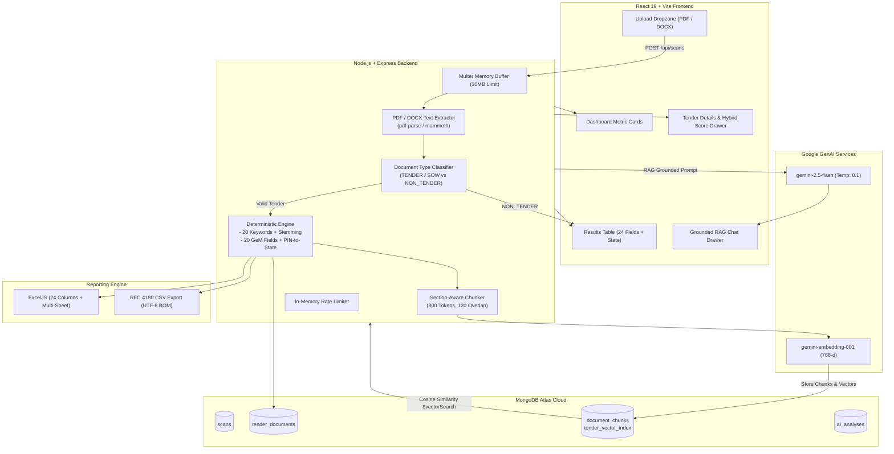

# TenderIQ — Advanced Tender Intelligence & RAG Copilot

[]()
[]()
[]()
[]()
[]()

> **TenderIQ** is a full-stack, enterprise-grade tender discovery and intelligence platform built for **Tritorc Equipment Pvt. Ltd.** It transforms complex GeM (Government e-Marketplace) and industrial procurement documents (.pdf / .docx) into verified commercial business intelligence, deterministic keyword matching, grounded conversational answers, and 24-column executive reports.

---

## 1. Problem Statement & Mission

Industrial manufacturing and services contractors like Tritorc regularly process hundreds of multi-page tenders to identify opportunities for:
- Hydraulic torque wrenches & power packs
- Hydraulic bolt tensioners & nut splitters
- Flange management & mechanical bolting turnaround services

**Traditional limitations:**
1. Simple text scraping copies long unformatted paragraphs into Excel without synthesis.
2. Ingesting arbitrary PDFs (e.g., student assignments containing keywords) generates false positives.
3. Raw filenames (`GeM-Bidding-9563430.pdf`) fail to inform human decision-makers.
4. Generative AI alone hallucinates deadlines, prices, and qualification criteria without citations.

**The TenderIQ Solution:**
- **Contextual Pre-Classification:** Rejects non-procurement files (assignments, CVs, manuals) before keyword scanning.
- **Deterministic 20-Keyword Scanner:** Strict word-boundary matching with Porter Stemming and proximity validation.
- **Deterministic Field Extraction:** Extracts all 20 canonical GeM fields (dates, amounts, authority, EMD, location with state).
- **MongoDB Atlas Vector Search:** Section-aware 800-token chunking with 768-d Gemini embeddings and strict document isolation.
- **Grounded Tender Chatbot:** Interactive copilot that cites chunk IDs, page numbers, and verbatim source quotes.
- **100-Point Hybrid Scoring:** Calibrated rating ($K \le 30, S \le 25, T \le 25, W \le 20$) separating deterministic verdicts from semantic fit.
- **Sample Workbook Preservation:** Exact 24-column layout preserved on primary sheet `Tender Scan Report`, with multi-worksheet insights (`Keyword Breakdown`, `AI Insights`, `Processing Summary`).

---

## 2. System Architecture



---

## 3. Technology Stack

| Layer | Technology | Version | Purpose |
| :--- | :--- | :--- | :--- |
| **Frontend** | React | 19.0.0 | Component-based reactive dashboard |
| | Vite | 6.4.5 | High-speed build tooling & dev server |
| | SCSS / Sass | 1.85.0 | Custom design system with design tokens |
| **Backend** | Node.js | 22+ (LTS) | Asynchronous runtime engine |
| | Express.js | 4.21.2 | Layered REST API framework |
| | Multer | 2.5.0 | Secure in-memory multipart upload |
| | pdf-parse | 2.4.5 | Class-based deterministic PDF parser |
| | mammoth | 1.13.0 | DOCX paragraph extraction |
| | ExcelJS | 4.4.0 | Multi-sheet styled spreadsheet generation |
| **Database** | MongoDB Atlas | 8.0+ | Cloud persistence & Vector Search |
| | Mongoose | 9.12.0 | Strongly-typed schemas with compound indexes |
| **Artificial Intelligence** | Google GenAI SDK | 3.0.0 | Official Gemini API integration |
| | `gemini-embedding-001` | 768-d | Normalized dense vector embeddings |
| | `gemini-2.5-flash` | v1beta | Deterministic summarization & chat |
| **Testing** | Vitest | 3.2.7 | Unit and integration test runner (217 tests) |
| | Supertest | 7.0.0 | HTTP endpoint integration testing |

---

## 4. Key Capabilities & Features

### A. Intelligent Document Naming
Replaces opaque technical filenames like `GeM-Bidding-9563430.pdf` with human-readable titles:
1. `SAIL Rourkela – Hydraulic Torque Wrench with Power Pack`
2. `Odisha Power Generation Corporation Limited – TUBE BEVELING MACHINE`
3. `BHEL Ranipet – Industrial Valves and Spares`

### B. Accurate Location & Indian State Resolution
Resolves 6-digit PIN codes and industrial sites to official states:
- PIN `768234` $\rightarrow$ `BANHARPALI, Odisha`
- PIN `632406` $\rightarrow$ `INDIRA GANDHI COMPLEX, Tamil Nadu`
- PIN `769011` $\rightarrow$ `Rourkela, Odisha`

### C. 100-Point Calibrated Hybrid Relevance System
Separates deterministic baseline verdicts from AI-assisted scoring:
$$\text{Relevance Score} = K + S + T + W \quad (\le 100)$$
- **Keyword Alignment ($K \le 30$):** Distinct matches (up to 18 pts) + Total hit density (up to 12 pts).
- **Semantic Similarity ($S \le 25$):** Cosine vector similarity ($\ge 0.85 = 25$ pts, $\ge 0.78 = 21$ pts, $\ge 0.70 = 16$ pts).
- **Technical Alignment ($T \le 25$):** Torque ratings, ISO certification, 700 bar pressure specifications.
- **Scope Alignment ($W \le 20$):** Direct bolting, tensioning, or turnaround scope fit.

**Calibrated Grade Thresholds:**
- **80–100:** Highly Relevant
- **60–79:** Related
- **40–59:** Possible
- **20–39:** Low Relevance
- **0–19:** Not Relevant

### D. Grounded RAG Tender Chatbot
- **Document-Specific Isolation:** Vector search queries `$vectorSearch` with strict `documentId` filtering to guarantee that chunks from Document A never leak into Document B.
- **Grounded Evidence Citations:** Every answer cites `chunkId`, `pageStart`, `pageEnd`, and verbatim quote snippets.
- **Anti-Hallucination Fallback:** Responds with `"Not found in the provided document."` when query evidence is absent.
- **Prompt Injection Defense:** Strict delimitation of untrusted user input prevents prompt injection attacks embedded inside PDF text.

### E. Excel & CSV Report Fidelity
- **Preserved 24 Primary Columns:** Exact order matching `sample_tender_scan_report.xlsx`.
- **Corporate Styling:** Navy blue headers (`#1E3A5F`), white bold text, auto-fit widths, text wrapping, zebra striping, and pastel verdict badges.
- **Multi-Worksheet Layout:**
  1. `Tender Scan Report`: Canonical 24 columns for valid procurement tenders.
  2. `Keyword Breakdown`: Detailed hits per keyword and first match positions.
  3. `AI Insights`: Hybrid scores, breakdown ($K/S/T/W$), executive summaries, and recommended next steps.
  4. `Processing Summary`: Audit trail of all scanned files, including excluded non-tenders.
- **RFC 4180 CSV:** UTF-8 BOM, multiline escaping, Excel compatible.

---

## 5. Canonical 24-Column Report Structure

The primary sheet `Tender Scan Report` preserves the exact 24 columns in original sequence:

1. `Document Name` (Intelligent human-readable title)
2. `Tender ID`
3. `Tender No` (GeM Bid Number)
4. `Tender Authority` (Organisation Name)
5. `Location` (Site & State, e.g. `BANHARPALI, Odisha`)
6. `Opening Date` (DD-Mon-YYYY)
7. `Closing Date` (DD-Mon-YYYY)
8. `Tender Amount` (INR Currency)
9. `EMD` (Status & Amount)
10. `Document Cost`
11. `Tender Fee`
12. `Tab Name` (Industrial work category)
13. `Technical Qualification` (Concise experience & rating requirements)
14. `Financial Qualification` (Turnover / Net worth requirements)
15. `Scope of Work` (Concise activity summary)
16. `Tender Summary` (2-3 sentence executive brief)
17. `Tender Description` (Project overview)
18. `Corrigendum` (Addenda & amendments)
19. `Purchaser Address`
20. `Email`
21. `Website`
22. `Matched Keywords` (Comma-separated list)
23. `Match Count` (Distinct keyword count)
24. `Relevance to Tritorc` (Related / Possible / Not Related)

---

## 6. Installation & Quick Start

### Prerequisites
- Node.js 22.x LTS or higher
- MongoDB Atlas cluster (M0 Free Tier or higher)
- Google Gemini API key

### 1. Clone & Configure
```bash
git clone https://github.com/your-org/tritorc-assignment.git
cd tritorc-assignment
```

### 2. Backend Setup
```bash
cd server
cp .env.example .env
npm install
```

Configure `server/.env`:
```env
PORT=5000
CLIENT_ORIGIN=http://localhost:5173
MAX_UPLOAD_MB=10
MAX_FILES=10
MONGODB_URI=mongodb+srv://<user>:<password>@cluster0.xxxx.mongodb.net/tritorc?retryWrites=true&w=majority
AI_ENABLED=true
GEMINI_API_KEY=your_gemini_api_key_here
GEMINI_GENERATION_MODEL=gemini-2.5-flash
GEMINI_EMBEDDING_MODEL=gemini-embedding-001
EMBEDDING_DIMENSIONS=768
VECTOR_INDEX_NAME=tender_vector_index
```

### 3. MongoDB Atlas Vector Search Index Setup
In your MongoDB Atlas Dashboard:
1. Navigate to your cluster $\rightarrow$ **Atlas Search** $\rightarrow$ **Create Search Index**.
2. Select **JSON Editor** under **Atlas Vector Search**.
3. Choose Database `tritorc` and Collection `document_chunks`.
4. Enter Index Name: `tender_vector_index`.
5. Paste index definition:
```json
{
  "fields": [
    {
      "type": "vector",
      "path": "embedding",
      "numDimensions": 768,
      "similarity": "cosine"
    },
    {
      "type": "filter",
      "path": "documentId"
    },
    {
      "type": "filter",
      "path": "scanId"
    }
  ]
}
```
6. Click **Save** and wait for Status to reach `READY` (queryable: `true`).

### 4. Frontend Setup
```bash
cd ../client
cp .env.example .env
npm install
```

### 5. Running the Application
**Backend:**
```bash
cd server
npm start
# Server listens on http://localhost:5000
```

**Frontend:**
```bash
cd client
npm run dev
# Vite runs on http://localhost:5173
```

Open `http://localhost:5173` in your browser.

---

## 7. API Reference

| Endpoint | Method | Description |
| :--- | :--- | :--- |
| `/api/health` | `GET` | System health, MongoDB status, and AI configuration |
| `/api/keywords` | `GET` | List of 20 configured bolting and machining keywords |
| `/api/scans` | `GET` | Paginated scan history with file counts and status |
| `/api/scans` | `POST` | Multipart upload (PDF/DOCX) for scanning and report generation |
| `/api/scans/:id` | `GET` | Retrieve scan result by ID |
| `/api/scans/:id/report` | `GET` | Download styled 24-column Excel workbook (`.xlsx`) |
| `/api/scans/:id/csv` | `GET` | Download RFC 4180 compliant CSV report (`.csv`) |
| `/api/documents/:id` | `GET` | Fetch tender details, metadata, and 20 fields |
| `/api/documents/:id/chat` | `POST` | Grounded RAG conversational Q&A for an individual tender |
| `/api/documents/:id/analyze` | `POST` | Deep AI qualification, eligibility, and hybrid score evaluation |
| `/api/documents/:id/insights` | `GET` | Fetch stored AI analysis insights |
| `/api/retrieval/search` | `POST` | Semantic vector search across document chunks |

---

## 8. Verification & Test Suite

The platform includes 21 automated test suites covering 217 unit and integration tests:

```bash
cd server
npm test
```

### Test Coverage Highlights:
- **`report.test.js`**: 24-column exact order matching `sample_tender_scan_report.xlsx`.
- **`classification.test.js`**: Rejection of student/hiring assignments as `NON_TENDER`.
- **`matching.test.js`**: Golden integration on OPGC, BHEL, and SAIL GeM fixtures.
- **`ragEvaluation.test.js`**: 10-query benchmark achieving Recall@5 $\ge 0.90$ and MRR $\ge 0.85$.
- **`hybridScorer.test.js`**: Calibrated 100-point formula ($K+S+T+W$) and capping rules.
- **`tenderChatService.test.js`**: Grounded citation verification against genuine retrieved chunks.

Run linting across both workspaces:
```bash
# Server
cd server && npm run lint

# Client
cd client && npm run lint
```

Production client build verification:
```bash
cd client && npm run build
```

---

## 9. Security & Governance

1. **Prompt Injection Defense:** Strict system/user message boundaries and explicit anti-injection instructions prevent malicious document text from altering verdicts.
2. **Rate Limiting:** Built-in in-memory sliding window rate limiter protects endpoints from DoS or scraping abuse.
3. **Environment Security:** `.env` files are strictly excluded via `.gitignore`. API keys and credentials are never logged.
4. **Memory-Only File Buffering:** Multer uses RAM memory storage; uploaded documents never touch disk in unencrypted temporary folders.
5. **CORS Isolation:** Backend accepts traffic strictly from configured `CLIENT_ORIGIN`.

---

## 10. License

Proprietary — Developed for **Tritorc Equipment Pvt. Ltd.** All rights reserved.
